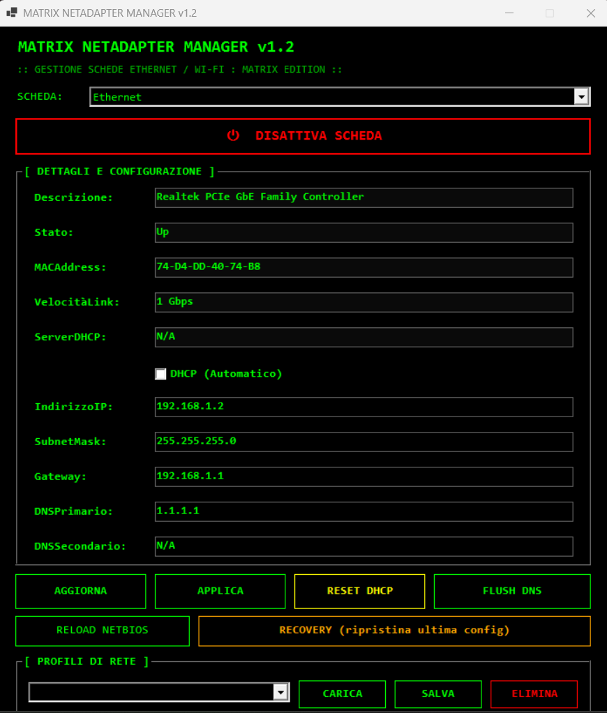

# 🖧 NetAdapter Manager

Gestione avanzata delle schede di rete su Windows con GUI: IP, subnet, gateway, DNS, DHCP, profili e **toggle Attiva/Disattiva** in stile Matrix.


## ✨ Feature

- ✅ **GUI Matrix**: sfondo nero, testo verde, font Consolas
- ✅ **Visualizzazione** dettagliata delle schede di rete (solo Ethernet e Wi-Fi reali, incluse USB Ethernet)
- ✅ **Toggle Attiva/Disattiva scheda** con un solo click (pulsante dinamico)
- ✅ **Anti-lockout**: avviso se provi a disattivare l'unica scheda connessa a Internet
- ✅ **Passaggio DHCP ↔ IP statico**
- ✅ **Modifica IP, subnet, gateway, DNS** con validazione
- ✅ **Conferma** prima di applicare (evita di perdere la connessione per errori)
- ✅ **RECOVERY**: ripristina l'ultima configurazione applicata
- ✅ **Profili di rete** salvabili (JSON)
- ✅ **Flush DNS** e **Reload NetBIOS**
- ✅ **Log su file** con dettagli + **log a schermo** in tempo reale
- ✅ **Status bar** con info scheda/stato/log
- ✅ **Auto-elevazione admin** (UAC)

## 📋 Requisiti

- **Windows 10 / 11**
- **PowerShell 7.2+** (scarica da https://aka.ms/powershell)
- **Permessi di amministratore** (per modificare le schede di rete)

## 🚀 Quick start

```powershell
git clone https://github.com/fabrytoolbox/NetAdapter-Manager.git
cd NetAdapter-Manager
Unblock-File .\NetAdapter-Manager.ps1
.\NetAdapter-Manager.ps1

Oppure doppio click su avvia.bat.

🎯 Casi d'uso
Configurare IP statico su una scheda di rete (server, NAS, stampanti)

Tornare a DHCP dopo configurazione statica

Salvare profili per reti diverse (casa, ufficio, VPN)

Diagnosticare problemi di rete (gateway, DNS)

Ripristinare la configurazione in caso di errore

Attivare/Disattivare rapidamente una scheda di rete (es. per bridging, DMZ, lab)

Gestire adattatori USB Ethernet per reti protette o isolate

🛡️ Sicurezza
Validazione di IP, subnet e gateway prima di applicare

Conferma prima di ogni modifica (evita errori irreversibili)

Anti-lockout sulla disattivazione dell'unica scheda con Internet

RECOVERY per ripristinare la configurazione precedente

Log di ogni operazione (file + schermo)

Auto-elevazione admin (UAC)

⚠️ Attenzione
Questo tool modifica la configurazione di rete del sistema. Se applichi un IP o un gateway errato, potresti perdere la connessione.

Usa RECOVERY per ripristinare l'ultima configurazione

In caso di problemi, riavvia il PC o usa la GUI di Windows per riconnetterti

Fai un backup dei profili esistenti prima di modifiche importanti

Il tool mostra solo schede Ethernet e Wi-Fi reali: le virtuali (VMware, VirtualBox, Hyper-V, TAP, Bluetooth, WAN Miniport) sono escluse automaticamente. Le USB Ethernet sono invece incluse perché utili per bridging/lab.

🐛 Problemi comuni
"Il gateway esiste già"
Risolto nella v1.1: ora IP e gateway vengono applicati separatamente.

"Ho perso la connessione dopo aver applicato"
Usa RECOVERY (pulsante arancione) per ripristinare l'ultima configurazione.

"PowerShell 7 non trovato"
Installa PowerShell 7 da https://aka.ms/powershell

"Non vedo la mia scheda di rete"
Il tool mostra solo schede Ethernet e Wi-Fi reali. Se la scheda è virtuale (VMware, Hyper-V, ecc.) o Bluetooth, è esclusa per design. Se invece è una scheda fisica e non compare, verifica che non sia disabilitata a livello di BIOS o che il driver sia installato.

📝 Changelog
v1.2 (Matrix Edition) — 2026-11-01
🎨 Nuova GUI Matrix: sfondo nero, testo verde, font Consolas, bottoni flat con bordi verdi

⚡ Nuovo pulsante Toggle dinamico: Attiva/Disattiva scheda selezionata

Rosso "DISATTIVA SCHEDA" quando la scheda è Up

Verde "ATTIVA SCHEDA" quando è Disabled/Down/Disconnected

Grigio "NON DISPONIBILE" quando è Not Present

🛡️ Anti-lockout: avviso se provi a disattivare l'unica scheda con Internet

🔍 Filtro schede: mostra solo Ethernet e Wi-Fi reali (incluse USB Ethernet)

Escluse: VMware, VirtualBox, Hyper-V, TAP, loopback, tunnel, Bluetooth, WAN Miniport

📺 Log a schermo in tempo reale con timestamp

📊 Status bar in basso con info scheda/stato/log attivo

🔧 Gestione errori migliorata (accesso negato, driver in uso, scheda Not Present)

♻️ Recovery, profili JSON, validazione IP/subnet, reset DHCP, flush DNS, reload NetBIOS (invariati)

v1.1
Prima versione con GUI classica, validazione IP, conferma, log, profili, recovery

Fix "Il gateway esiste già": IP e gateway applicati separatamente

v1.0
Rilascio iniziale

📜 Licenza
MIT (vedi LICENSE).

🙏 Crediti
Ispirato al tema Matrix (colori)

PowerShell 7 + WinForms

Fabry Toolbox
